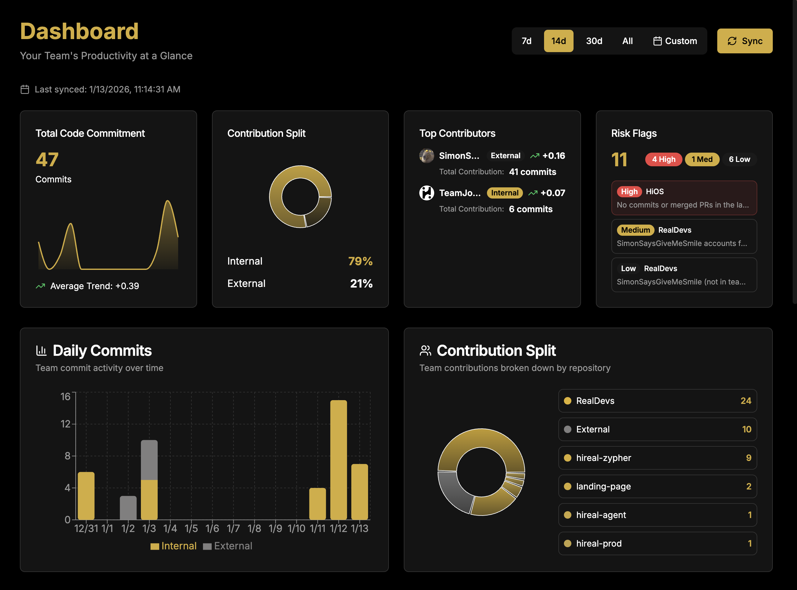
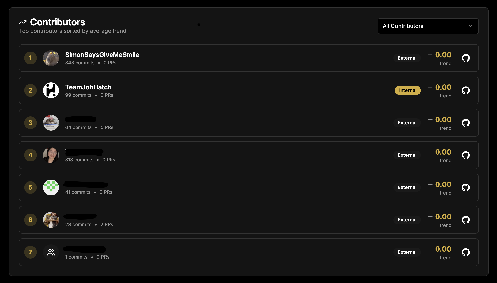

# RealDevs - Team Momentum Analytics

## Introduction

**RealDevs** is a powerful analytics tool designed for project team leads and startup founders who need a quick, daily overview of their team's performance. Whether you're managing a growing engineering team or tracking progress across multiple projects, RealDevs provides the insights you need to spot potential risks, monitor project progress, and compare team member contributions—all at a glance.

### Key Capabilities

- **📊 Daily Performance Overview**: Get an instant snapshot of your team's productivity with comprehensive dashboards that track commits, pull requests, and contributions across all your repositories.

- **🚨 Risk Detection**: Automatically identify potential issues before they become problems—from inactive team members to single points of failure and stale repositories.

- **📈 Progress Monitoring**: Track the momentum of each project with visual analytics, trend indicators, and contribution breakdowns by repository and team member.

- **👥 Team Comparison**: Easily compare progress between team members with detailed contributor rankings, activity metrics, and performance trends.

### Dashboard Overview

**Your Team's Productivity at a Glance**



The main dashboard provides a comprehensive view of your team's activity, including:
- Total code commitment trends with visual charts
- Internal vs external contribution splits
- Top contributors with performance metrics
- Daily commit activity over time
- Risk flags with severity indicators
- Repository-level contribution breakdowns

**Contributors Analysis**



The contributors page offers detailed insights into individual team member performance:
- Ranked contributor list sorted by average trend
- Commit and PR statistics for each team member
- Internal vs external contributor classification
- Performance trends and momentum scores
- Quick filtering and sorting options

**Phase 1 MVP**: Local-first GitHub activity tracker with web dashboard. Monitor team momentum, identify risks, and generate weekly recaps — all without surveillance.

## Features

- 🔐 **Local-first**: Runs entirely on your laptop with Docker or standalone
- 📊 **Team Momentum Metrics**: Track commits, PRs, issues with explainable scoring
- 🚨 **Risk Flags**: Identify bottlenecks, inactivity, single points of failure
- 📝 **Weekly Recaps**: Auto-generated neutral summaries
- 🎨 **Modern UI**: Dark mode, frosted glass effects, developer-oriented design
- 🔒 **Privacy**: PAT stored encrypted locally, no external data transmission

## Quick Start

### Prerequisites

- Node.js 24 LTS
- Python 3.14.2
- Docker & Docker Compose (optional)

### Option A: Docker Compose (Recommended)

```bash
# Clone and run
make docker-up

# Access at http://localhost:3000
```

### Option B: Manual (Two Terminals)

**Terminal 1 - Backend:**
```bash
# Option 1: Using Make (from project root)
make api-dev

# Option 2: Manual setup
cd apps/api
python -m venv venv
source venv/bin/activate  # On Windows: venv\Scripts\activate
pip install -r requirements.txt
flask run --host=0.0.0.0 --port=8000
```

**Terminal 2 - Frontend:**
```bash
# Option 1: Using Make (from project root)
make web-dev

# Option 2: Manual setup
cd apps/web
npm install
npm run dev
```

Access at `http://localhost:3000`

## GitHub PAT Setup

1. Go to GitHub → Settings → Developer settings → Personal access tokens → Fine-grained tokens
2. Create new token with **read-only** permissions:
   - ✅ Repository contents (read)
   - ✅ Pull requests (read)
   - ✅ Issues (read)
   - ✅ Metadata (read)
3. Copy token and paste in RealDevs Credentials page

## Project Structure

```
RealDevs/
├── apps/
│   ├── api/          # Flask backend
│   │   ├── app/
│   │   │   ├── api/
│   │   │   ├── models/
│   │   │   ├── services/
│   │   │   └── utils/
│   │   ├── tests/
│   │   └── requirements.txt
│   └── web/          # Next.js frontend
│       ├── src/
│       │   ├── app/
│       │   ├── components/
│       │   ├── lib/
│       │   └── types/
│       └── package.json
├── docs/
├── docker-compose.yml
├── Makefile
└── README.md
```

## Available Commands

```bash
make help              # Show all commands
make docker-up         # Start with Docker Compose
make docker-down       # Stop Docker services
make docker-logs       # View logs
make api-dev           # Run Flask dev server
make web-dev           # Run Next.js dev server
make test              # Run all tests
make clean             # Clean all build artifacts
```

## Configuration

### Backend (.env in apps/api/)
```env
FLASK_ENV=development
HIDEVS_SECRET_KEY=your-secret-key-here
DATABASE_URL=sqlite:///./realdevs.db
```

### Frontend (.env.local in apps/web/)
```env
NEXT_PUBLIC_API_URL=http://localhost:8000/api
```

## Architecture

### Backend (Flask)
- **REST API**: Clean endpoint design with Pydantic schemas
- **GitHub Integration**: httpx client with pagination & rate limit handling
- **Storage**: SQLite with SQLAlchemy 2 + Alembic migrations
- **Security**: Fernet encryption for PAT storage

### Frontend (Next.js)
- **App Router**: React 19.2 with TypeScript
- **Data Fetching**: TanStack Query for caching & optimistic updates
- **UI**: shadcn/ui components with Tailwind CSS
- **Design**: Dark mode, frosted glass, gradient effects

## Pages

1. **Dashboard**: Commitment trends, internal vs external activity, top contributors, red flags
2. **Credentials**: PAT management, team member configuration
3. **Settings**: Red flag thresholds, notification preferences

## Security Notes

- ✅ PAT encrypted at rest with Fernet (derived from `HIDEVS_SECRET_KEY`)
- ✅ Never logged or exposed to frontend after submission
- ✅ All data stored locally in SQLite
- ✅ "Delete & Reset" button wipes all data
- ⚠️ For production deployment, implement proper secrets management

## Deployment (Self-Host)

See [docs/DEPLOYMENT.md](./docs/DEPLOYMENT.md) for hosting options.

**Warning**: Phase 1 is designed for local-first use. Hosting PAT flow requires additional security measures.

## Development

### Run Tests
```bash
# Backend tests
cd apps/api
pytest

# Frontend tests (optional)
cd apps/web
npm test
```

### Database Migrations
```bash
cd apps/api
alembic revision --autogenerate -m "description"
alembic upgrade head
```

## Roadmap

- **Phase 1** (Current): Local-first with PAT
- **Phase 2**: GitHub OAuth, multi-user support
- **Phase 3**: LLM-powered insights, Slack integration
- **Phase 4**: SaaS offering with team dashboards

## Contributing

RealDevs is built for transparency. Contributions welcome!

## License

MIT License - see [LICENSE](./LICENSE)

---

Built with ❤️ for engineering teams who value trust over surveillance. 12

